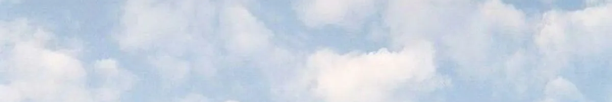

  
   
  <h1>hi, i'm alyah ♡</h1>
  
<b>student developer · AI/ML explorer · web creator</b>

  

    
    
  

  
<i>making little things, learning big things, and collecting cookies along the way.</i>

---

<table>
  <tr>
    <td width="58%" valign="top">
      <h3>☁️ about this player</h3>
      
I'm a student developer who likes building creative projects at the intersection of AI, the web, and playful experiences.

      
Currently exploring computer vision, interactive web apps, and all the little details that make software feel delightful.

      
<b>currently learning:</b> AI/ML · React · making better things by building them

    </td>
    <td width="42%" valign="top" align="center">
      <h3>📝 quest log</h3>
      
☑ make something people can play

      
☐ explore more computer vision

      
☐ ship a tiny web experiment

      
☐ keep learning, one commit at a time

    </td>
  </tr>
</table>

## 🍪 cookie corner

  
  
<b>take a tiny break! (COMING SOON!)</b>

## 🧸 my little toolkit

  

## 🌷 explore my corner of the internet

  <a href="https://github.com/lyri3aly">gitHub (you're here!)</a> ·
  <a href="https://alyahli.ca">portfolio</a> ·
  <a href="https://github.com/lyri3aly?tab=repositories">all my projects</a>
    
  made with coffee and a cookie ♡

